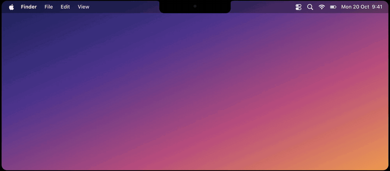

# Topnotchers

Your coding agents, living in your Mac's notch.



Every Claude Code and Codex session gets a little mascot that peeks out from behind the notch:
Clawd for Claude, the Codex pet (or any of your installed Codex pets) for Codex. They animate
while working, wave when they need you, and hop when they're done.

- **Answer from the notch.** Claude's questions and permission prompts drop down from the
  island, so you can reply without leaving what you're doing.
- **One click back.** Click a mascot to jump straight to its Ghostty tab or app.
- **Hover for detail.** Task, live action and 5-hour usage; ←/→ to flip between sessions.
- **Stays out of the way.** In full screen it hides with the menu bar and pops in for a moment
  when an agent finishes, so you can watch something while they work.

**Insanely light.** About 0.7% of one CPU core while an agent is working and its mascot is
animating, and around 42 MB of memory. It's native AppKit and Core Animation: no Electron, no
web view, no polling. Agents report in through hooks over a Unix socket, idle mascots settle so
nothing redraws when nothing is happening, and the window is only a notch tall.

## How it works

Claude Code and Codex report each session through their hooks, so a mascot appears the moment
you start an agent in a terminal (or the Codex app) and leaves when you quit it.

| State | What you see |
| --- | --- |
| **Working** | The mascot animates; hover to see the live action ("Editing Tray.swift", "Running the tests"). |
| **Needs you** | A pulsing orange dot, and the question or permission prompt drops down from the notch. Pick an option, type your own answer, or open the chat. If you're already looking at that terminal, the agent asks there instead. |
| **Done** | A hop and a green dot that stays until you look: hover its side, or switch to its tab or app. |
| **Idle** | The mascot settles and nothing redraws. |

- **Hover a side** and it widens into a tray: agent, task, live action and 5-hour usage.
- **Several sessions** of the same agent stack behind one another, the most urgent in front. The
  tray shows one dot per session, coloured by state; hover a dot or use ←/→ to flip between them,
  Return to open one, Esc to close.
- **Click** a mascot to jump to that session's Ghostty tab, or its app.
- **Full screen** hides the island along with the menu bar; it comes back at the top edge, pops in
  for a moment when an agent finishes, and stays up while a question waits.

## Install

```sh
curl -fsSL https://raw.githubusercontent.com/joey-david/topnotchers/master/install.sh | bash
```

or with Homebrew:

```sh
brew install joey-david/tap/topnotchers && topnotchers-setup
```

Needs an Apple silicon Mac on macOS 14 or later, notch or not, and the Xcode Command Line Tools
(`xcode-select --install`). Topnotchers builds on your machine, so there's no Gatekeeper
warning. Setup wires up the Claude Code and Codex hooks and starts the app at login (toggle it
from the menu-bar item).

Then approve the hooks once with `/hooks` in Codex, and let Topnotchers control Ghostty when
macOS asks (that's how a click focuses the right tab).

From a clone: `./install.sh` builds and installs, `./demo.sh` plays a tour with throwaway
sessions.

## Other agents

Up to 10, each on the left or right, set from the menu-bar item or
`~/.topnotchers/config.json`. Anything can report in:

```sh
~/.topnotchers/bin/topnotchers-hook --agent <id>                       # Claude-style hook JSON on stdin
~/.topnotchers/bin/topnotchers-hook emit --agent <id> --state working  # or question, done, end
```

---

Made by Joey. Follow [@t0rt0ised](https://x.com/t0rt0ised) for what's next, and if Topnotchers
saves you some tab-switching, a ⭐ helps other people find it.
